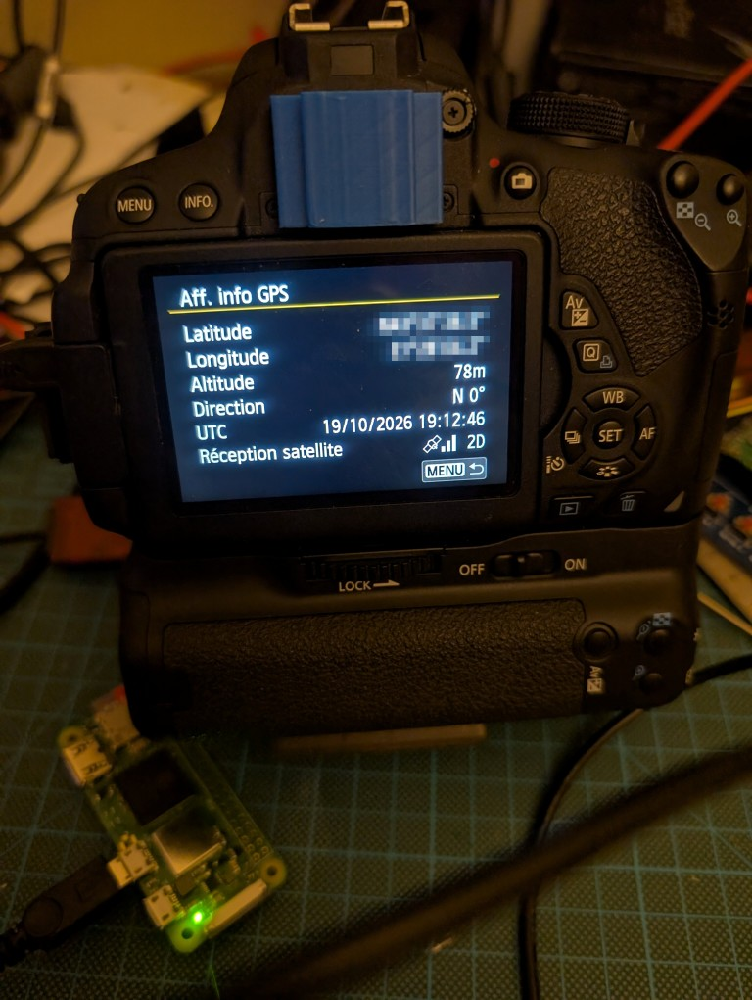

This is work in progress...

I have a running implementation (not ready to be shared) on a pi zero that pushes "static" GPS coordinates. Works great, can set time, pictures contain proper GPS data.

I hope that someone will build on that and do something awesome.

# Canon GP-E2 — USB protocol description

The GP-E2 speaks PTP over USB, with Canon-specific operations: 0x91A0–0x91AA towards a PC, 0x91D5–0x91DE towards a camera. This document describes both uses; the camera side was verified with an EOS 700D (firmware 1.1.5), other bodies remain to be tested.

## USB identification

The GP-E2 has a mini-USB AB socket: with a mini-B plug it is a **device** (facing a PC), with a mini-A plug it is the **host** (facing the camera, mini-A ↔ mini-B cable). The switch must be set to ON, not LOG, to connect to a PC.

| Item | Value |
| --- | --- |
| VID:PID | 04A9:3251, bcdDevice 0x0001, bcdUSB 2.00 |
| Strings | 1 = "Canon Inc.", 2 = "Canon GP-E2", no USB serial number |
| Speed | Full Speed (12 Mb/s), bMaxPacketSize0 = 64 |
| Configuration | 1 configuration, 39 bytes, bmAttributes 0xC0 (self-powered), MaxPower 100 mA; GET\_STATUS → 0x0001 |
| Interface 0 | class 06 / 01 / 01 (Still Image, PTP), 3 endpoints |
| Endpoints | 0x81 bulk IN 64 bytes; 0x02 bulk OUT 64 bytes; 0x83 interrupt IN 8 bytes, interval 10 (never used) |
| Class requests | Get Device Status (0x67) → OK; Cancel (0x64); Device Reset (0x66) |

Standard PTP containers, little-endian: `u32 length, u16 type (1 command, 2 data, 3 response, 4 event), u16 code, u32 transaction`, followed by u32 parameters or the data. When an IN container is an exact multiple of 64 bytes, the GP-E2 then sends an empty packet (ZLP).

Response codes used: 0x2001 OK, 0x2005 operation not supported, 0x2019 busy (Device\_Busy).

## Connecting to a PC

The PC opens a session and then puts the GP-E2 in remote mode; no standard PTP storage operation is needed. Initialisation sequence:

1. OpenSession (0x1002), parameter 1.
2. GetDeviceInfo (0x1001).
3. Canon GetDeviceInfoEx (0x9108).
4. SetRemoteMode (0x9114), parameter 1.
5. 0x91A7 (current mode): response parameter 0 = normal, 1 = updater. A reading tool should stop if the value is not 0.

**GetDeviceInfo** (187 bytes): vendor extension 0x0000000B (Canon), version 200, PTP 1.00; manufacturer "Canon Inc.", model "Canon GP-E2", version "4-2.0.2", serial number (10 digits); no events or properties declared; format 0x3801. 33 operations in normal mode: 0x1001–0x100A, 0x101B, 0x1014–0x1016, 0x9108, 0x9113, 0x9114, 0x9013, 0x911D, 0x911E, 0x91A0–0x91AA, 0x91FE, 0x91FF.

**GetDeviceInfoEx** (52 bytes): `u32 length (0x34), u32 0, u32 7`, then 7 property codes as u32 (0xD16C, 0xD16D, 0xD14D, 0xD14E, 0xD14F, 0xD16E, 0xD16F), then `u32 2, u32 0, u32 0, u32 1`.

Advertised storage: 0x80000001, label "V", built-in RAM, proprietary filesystem 0x8001, capacity 0. Logs do not go through PTP objects but through the 0x91Ax operations.

| Opcode | Function | Parameters | Data / response |
| --- | --- | --- | --- |
| 0x91A0 | switch to updater mode (reboot) | – | – |
| 0x91A1 | send a firmware block | offset, length | data host → GP-E2 |
| 0x91A2 | erase **all** logs | – | immediate response |
| 0x91A3 | list logs | – | list (see below) |
| 0x91A4 | read a log | handle, offset, size | block; response parameter = bytes read |
| 0x91A5, 0x91A6 | unknown | – | – |
| 0x91A7 | current mode | – | parameter 0 normal, 1 updater |
| 0x91A8 | start firmware update | .FIR size | – |
| 0x91A9 | block requested by the GP-E2 | – | parameters offset, length; (0, 0) = done |
| 0x91AA | status of a long operation | – | 0x2019 while running, then 0x2001 |

## Logs

One log per day (named `YYYYMMDD.log`), read in blocks of the size given by property 0xD16E (8192 bytes). Each point is 32 bytes; NMEA is rebuilt on the PC side.

**0x91A3, list**: `u32 count`, then 44 bytes per log:

| Offset | Size | Content |
| --- | --- | --- |
| 0 | 4 | handle (u32) |
| 4 | 16 | ASCII name padded with zeros ("20170809.log") |
| 20 | 4 | size in bytes (u32, multiple of 32) |
| 24 | 4 | start date: DD MM YY 00 |
| 28 | 4 | start time: hh mm ss 00 |
| 32 | 4 | 0 |
| 36 | 4 | end time: hh mm ss 00 |
| 40 | 4 | 0 |

**0x91A4, read**: parameters handle, offset, size (0x2000); the GP-E2 returns the block and, as response parameter, the number of bytes read. Loop until the advertised size is reached.

**32-byte point** (little-endian):

| Byte | Content |
| --- | --- |
| 0 | 0x5A, start marker |
| 1 | flags: bit 0 negative altitude; bit 1 unknown (always 1); bit 2 East (0 = West); bit 3 North (0 = South); bits 4–7 zero |
| 2–4 | date DD MM YY |
| 5–7 | UTC time hh mm ss |
| 8–9 | milliseconds (u16) |
| 10 | latitude, degrees |
| 11 | latitude, minutes |
| 12–13 | latitude, minute fraction × 10000 (u16) |
| 14–15 | longitude, degrees (u16) |
| 16 | longitude, minutes |
| 17–18 | longitude, minute fraction × 10000 (u16) |
| 19–20 | altitude in metres, absolute value (u16) |
| 21 | number of satellites |
| 22–23 | HDOP: integer part, decimal part |
| 24 | unknown (21–36; probably the best signal-to-noise ratio in dB-Hz) |
| 25–30 | 0 |
| 31 | 0xA5, end marker |

Usual values of byte 1: 0x0E N/E, 0x0A N/W, 0x06 S/E, 0x02 S/W (+1 for negative altitude).

**Reference .log file** (as written by GPS Log File Utility): first line `@CanonGPS/ver1.0/wgs-84/Canon GP-E2/<serial number>`, then one `$GPGGA` / `$GPRMC` pair per point, CRLF line endings, including the last line. Degrees are written with 2 digits (latitude) and 3 digits (longitude).

## Properties and logging interval

Settings go through the standard PTP operations GetDevicePropDesc (0x1014), GetDevicePropValue (0x1015) and SetDevicePropValue (0x1016). The logging interval has no dedicated operation.

| Property | Type | Access | Value | Role |
| --- | --- | --- | --- | --- |
| 0xD14D | UINT32 | read/write | default 15; enum 1, 5, 10, 15, 30, 60, 120, 300 | interval in seconds (camera-side access) |
| 0xD14E | UINT32 | read | 600 | unknown |
| 0xD14F | UINT32 | read/write | same enumeration | interval in seconds (PC-side access) |
| 0xD16C | STRING | read | "1910500208" | serial number |
| 0xD16D | UINT32 | read | 0x80000323 | model ID (= first 4 bytes of the .FIR) |
| 0xD16E | UINT32 | read | 8192 | block size for 0x91A4 |
| 0xD16F | UINT32 | read | 8192 | block size (writing or firmware?) |

D14D and D14F are one value under two codes: the GP-E2 keeps them in sync, and a setting made from the camera shows up in both. D14F descriptor: type 0x0006, access 1, default 15, current value, form 0x02 (enumeration) with 8 values. A value outside the enumeration should be rejected (0x201C).

## Erasing

Erasing always removes **all** logs and takes about 14.5 s, whatever the content.

1. 0x91A2 (no parameter) → 0x2001 immediately: erasing starts.
2. 0x91AA (no parameter) about every 0.5 s → 0x2019 while erasing, then 0x2001.
3. 0x91A3 then returns 0 logs (`00 00 00 00`).

There is no selective erase. A reading tool must never send 0x91A2 by mistake.

## Firmware update

The .FIR file is sent as is, in blocks that the GP-E2 requests itself; the whole operation takes about 22 s plus the reboot. The same version can be reinstalled.

1. **Normal mode**: usual initialisation, then GetDevicePropValue 0xD16D. It must match the model ID of the .FIR (0x80000323, its first 4 bytes).
2. 0x91A7 → 0, then **0x91A0** (no parameter): the GP-E2 reboots into updater mode. A new session must be opened; transaction IDs start again from 0.
3. **Updater mode**: GetDeviceInfo lists only 27 operations (0x91A0, 0x91A1, 0x91A7, 0x91A8, 0x91A9, without 0x91A2–0x91A4); 0x91A7 returns 1.
4. **0x91A8**(.FIR size, e.g. 0x801EC = 524,780 bytes): start of transfer.
5. **Loop driven by the GP-E2**: 0x91A9 → response parameters (offset, length) of the wanted block; the host answers with **0x91A1**(offset, length) carrying that part of the file in the data phase. Repeat until 0x91A9 returns (0, 0).
6. The GP-E2 reboots into normal mode (about 7 s); 0x91A3 then returns 0 logs.

Order of blocks requested for 2.0.2 (131 blocks): header 0x0–0x400, then a first pass from 0x130 to the end (\~0.08 s per block), then a second pass from 0x1E4 to the end (\~0.13 s per block). The first pass looks like verification, the second like flash writing.

**.FIR header** (gpe20202.FIR, 524,780 bytes):

| Offset | Content |
| --- | --- |
| 0x00 | u32 0x80000323 (model ID) |
| 0x10 | version in ASCII ("2.0.2") |
| 0x20 | 4 bytes, probably a checksum |
| 0x30 | 0x130, start of data |
| 0x38 | 0x801EC, file size |
| 0x60 | 0x130 / 0x800BC: section start and length |
| 0x68, 0x88 | 20 bytes each (probably SHA-1 digests) |

Data from 0x130 onwards is encrypted (entropy 7.99 bits/byte, no repeated block): the firmware can be reinstalled but neither read nor modified.

## Connecting to a camera

The roles are reversed: the GP-E2 is the **USB host and PTP initiator**, the camera is the responder. The GP-E2 pushes its data with Canon operations and periodically polls the camera's events; the camera never asks for anything directly.

**Initialisation** (accepted by the EOS 700D, which then enables its GPS menus):

1. OpenSession (0x1002), parameter 1.
2. GetDeviceInfo (0x1001).
3. SetRemoteMode (0x9114), parameter 9: the bit combination 0x9 identifies a GP-E2-type GPS receiver.
4. SetEventMode (0x9115), parameter 1.
5. **0x91D5**, parameter 1: GPS connected.

To disconnect: 0x91D5 with parameter 0 (the camera shows "GPS not connected"), then CloseSession (0x1003).

**GPS operations** (GP-E2 → camera, response 0x2001):

| Opcode | Parameters | Data sent | Role |
| --- | --- | --- | --- |
| 0x91D5 | 1 / 0 | – | GPS connected / disconnected |
| 0x91D7 | – | – | queries the camera clock; response (1, value), 0 on the 700D (no high-precision clock) |
| 0x91D8 | action (3 = end of clock setting) | – | one-second pulse / end of time sync |
| 0x91D9 | – | `[u32 length][128 bytes]` | position, altitude, time and quality |
| 0x91DA | – | `[u32 16][u32 status][u32 level][u32 state]` | satellite reception |
| 0x91DB | – | `[u32 48][struct tm]` | UTC time for setting the clock |
| 0x91DC | – | data | accepted, no visible effect |
| 0x91DD | – | `[u32 16][ref.][byte][u16 0][u32 num][u32 den]` | direction (compass) |
| 0x91DE | level | – | battery status |
| 0x9116 | – | (received) events | polling the camera's events |

**Operating loop**: GetEvent (0x9116) about once a second; at each interval, 0x91D9 then 0x91DA and 0x91DE (and 0x91DD if the compass is used). By default data is sent every 15 s, then at the interval chosen in the camera's GPS menu.

GetEvent returns a series of records `[u32 size][u32 type][payload]`, terminated by a record of size 8 and type 0.

| Event | Payload | Meaning |
| --- | --- | --- |
| 0xC189 | `u32 0xD14D, u32 seconds` | interval chosen in the GPS menu; at first the value may be out of range (e.g. 0x3C00) and must be ignored |
| 0xC1ED | `u32 0` | time request: the user confirmed "Apply" |
| 0xC1EC | `u32 5` | time received and written to the camera clock |
| 0xC1EB | `u32 0` | clock setting cancelled |
| 0xC1EE | `u32 100` or `u32 0` | opening / closing of GPS screens (exact role uncertain) |
| 0xC1DD | `u32 1` | on connection (role unknown) |
| 0xC1A4, 0xC18E | various | on connection (role unknown) |

The first GetEvent also returns the camera's full property state (several KB), which can be ignored.

## GPS information (0x91D9)

The position is a 128-byte structure modelled on the EXIF GPS tags: references as text, values as rationals `{u32 numerator, u32 denominator}`, little-endian. The 0x91D9 data is `[u32 length = 132][structure]`. The fields end up unchanged in the EXIF of photos.

| Offset | Size | Content | EXIF |
| --- | --- | --- | --- |
| 0x00 | 4 | "N" or "S" + zeros | GPSLatitudeRef |
| 0x04 | 24 | latitude: 3 rationals | GPSLatitude |
| 0x1C | 4 | "E" or "W" + zeros | GPSLongitudeRef |
| 0x20 | 24 | longitude: 3 rationals | GPSLongitude |
| 0x38 | 1 (+3) | 0 = above, 1 = below sea level | GPSAltitudeRef |
| 0x3C | 8 | altitude in metres (rational) | GPSAltitude |
| 0x44 | 24 | UTC time: h/1, m/1, (s × 1000 + ms)/1000 | GPSTimeStamp |
| 0x5C | 2 | number of satellites as text ("12") | GPSSatellites |
| 0x5E | 2 | status as text ("A" valid, "V" invalid) | GPSStatus |
| 0x60 | 2 (+2) | measure mode as text ("2" or "3") | GPSMeasureMode |
| 0x64 | 8 | DOP (rational, e.g. 310/100) | GPSDOP |
| 0x6C | 8 | map datum as text ("WGS-84") | GPSMapDatum |
| 0x74 | 11 | UTC date "YYYY:MM:DD" + zero | GPSDateStamp |
| 0x7F | 1 | 0 (padding) | – |

**Angle format** ("degrees, decimal minutes", as in NMEA): degrees/1, (minutes × 10000 + fraction)/10000, 0/1. Example: 43.6274917° = 43/1, 376495/10000, 0/1. The camera checks that denominators are non-zero and that latitude does not exceed 90°.

The measure mode (0x60) is only written to the EXIF: the camera's 2D/3D display comes from 0x91DA. The camera's automatic clock setting ("Auto" setting) uses the UTC time and date from this structure.

## Satellites, battery, compass

**0x91DA, reception**: `[u32 16][u32 status][u32 level][u32 state]`.

| Field | Effect on the camera |
| --- | --- |
| level | number of reception bars, 0 to 3 (4 and above = 0 bars) |
| state, bits 0–1 | fix type: 0 none, 1 2D without altitude, 2 3D, 3 2D with altitude |
| state, bit 2 (0x4) | valid time: enables the "Apply" command (clock setting) |
| status | no visible effect (values 0 to 8 tried) |

Typical values for a receiver with a 3D fix and valid time: status 1, level 2 or 3, state 6.

**0x91DE, battery**: one parameter, the GP-E2 battery level (2 = the camera's default value). The exact scale is not confirmed.

**0x91DD, direction**: `[u32 16][u8 reference][u8 unknown][u16 0][u32 numerator][u32 denominator]`. Reference in ASCII: "M" magnetic north, "T" true north; direction in degrees = numerator / denominator (e.g. 19000/100). Only taken into account if the compass is enabled in the camera's GPS menu; maps to GPSImgDirectionRef / GPSImgDirection in the EXIF.

## Setting the camera clock

The forced clock setting ("Apply" in the GPS menu) takes four messages; it is only offered when the satellite state has bit 0x4 set.

1. **Camera → GP-E2**: the user confirms the displayed time; the camera posts **0xC1ED** and shows a waiting dialog (timeout about 60 s).
2. **GP-E2 → camera**: **0x91DB** with `[u32 48][struct tm]`, the UTC time of the current second.
3. **Camera**: it adds 1 s, writes its clock on reception, answers 0x2001 after about 2 s, then posts **0xC1EC** with value 5.
4. **GP-E2 → camera**: **0x91D8**, parameter **3**, at the start of the next second (like a one-second pulse). The waiting dialog closes: the clock has been set.

Without step 4, the camera stays stuck on the waiting dialog.

**struct tm**: 11 signed 32-bit integers, little-endian.

| Index | Field | Example (2026-10-19 20:27:17 UTC) |
| --- | --- | --- |
| 0 | seconds (0–59) | 17 |
| 1 | minutes | 27 |
| 2 | hours | 20 |
| 3 | day of month (1–31) | 19 |
| 4 | month (**0–11**) | 9 |
| 5 | year − 1900 | 126 |
| 6 | day of week (0 = Sunday) | 1 |
| 7 | day of year (0–365) | 291 |
| 8 | daylight saving flag | 0 |
| 9 | UTC offset | 0 |
| 10 | time zone | 0 |

**Accuracy**: since the camera adds 1 s on reception, the time of the current second should be sent just before the next second (around 900 ms). Sent at an arbitrary moment, the camera clock ends up ahead by a fraction of a second, up to 1 s.

**Warning**: 0x91DB must follow this format exactly. Shorter data (for instance a 4-byte Unix time) **freezes the camera completely**; it then has to be recovered by removing the battery.

## Open questions

The PC side is fully described, apart from 0x91A5, 0x91A6, property 0xD14E (600), byte 24 and bit 1 of the log points. On the camera side, the following remain open:

| Item | Status |
| --- | --- |
| Exact SetRemoteMode parameter | 9 works; the value actually sent by the GP-E2 may have other bits set |
| Exact order and timing of messages | 15 s by default, then the chosen interval; the 0x91D9 / 0x91DA / 0x91DE order is assumed |
| 0x91D8 | only parameter 3 is confirmed; values 1, 2 and 6 are accepted (1 triggers 0xC1EC with value 4; 6 would report a failed clock setting), real use unknown |
| When 0x91DB is sent | inferred from the camera's +1 s, to be confirmed |
| "status" field of 0x91DA | no visible effect |
| 0x91DE | scale of the battery level |
| 0x91DD | byte after the reference; direction display to be checked |
| 0x91DC | expected content unknown |
| Events 0xC1A4, 0xC1DD, 0xC18E, 0xC1EE | role unknown; no answer needed |
| Hot-shoe connection | not covered here; only the USB connection is documented |
| Other camera bodies | verified on the EOS 700D (firmware 1.1.5) only; feedback welcome |
